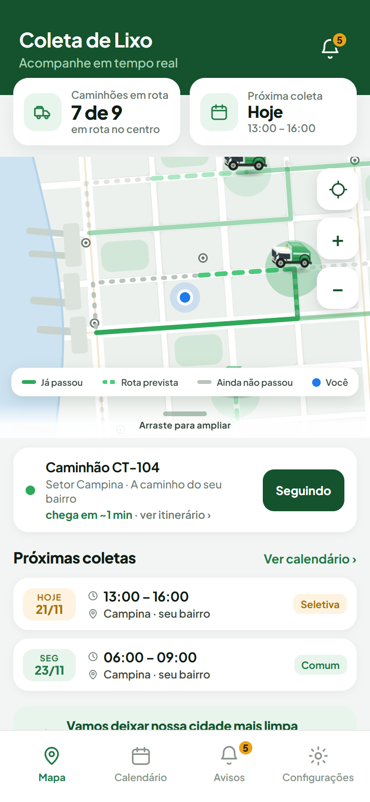
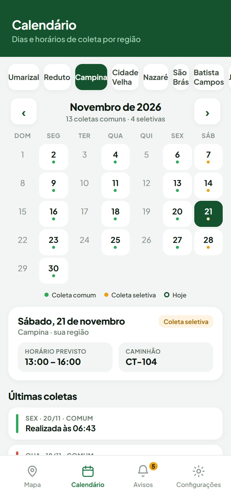
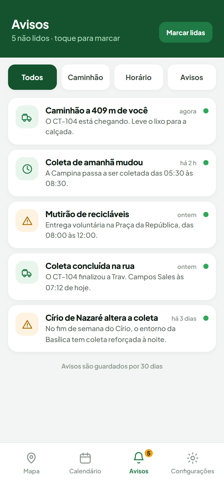
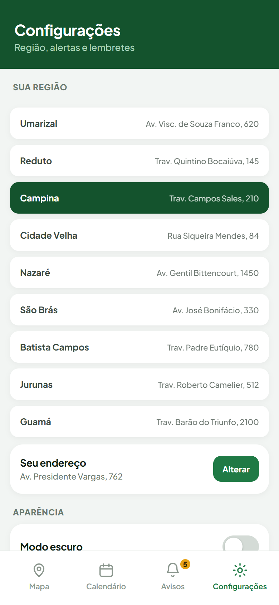
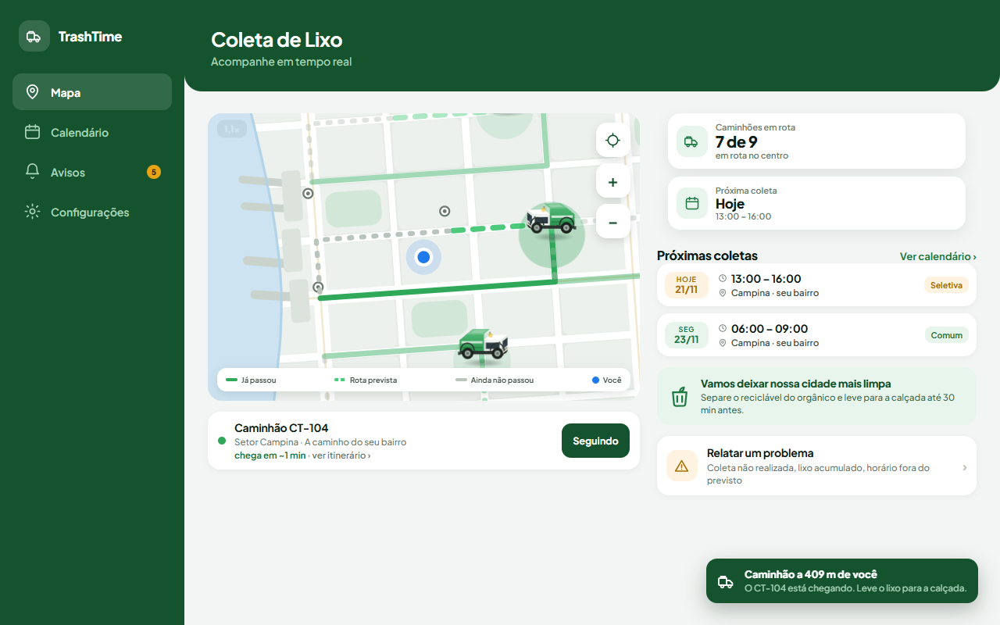
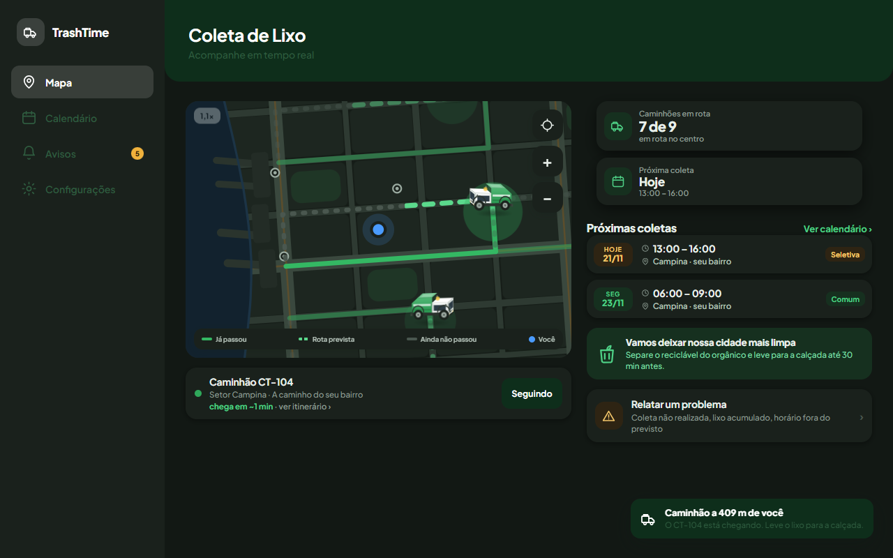

<h1 align="center">🚛 TrashTime</h1>

<p align="center">
  Acompanhamento em tempo real da coleta de lixo no centro de <strong>Belém do Pará</strong>.
</p>

<p align="center">
  <em>🇺🇸 A web app (PWA) that tracks garbage trucks in real time in downtown Belém, Brazil —
  built with Vue 3 and Vite, with a hand-drawn SVG map and offline support.</em>
</p>

<p align="center">
  <a href="https://trashtime.vercel.app"></a>
</p>

<p align="center">
  
  
  
  
  
  
</p>

---

## 📋 Sobre o projeto

O **TrashTime** é um aplicativo web que mostra ao morador onde estão os caminhões de
coleta de lixo, por onde já passaram e o que ainda falta. Ele informa os dias e horários
de coleta de cada bairro, avisa quando o caminhão está se aproximando e permite registrar
um problema quando o serviço falha.

O app é ambientado no centro de Belém e cobre nove bairros: **Umarizal**, **Reduto**,
**Campina**, **Cidade Velha**, **Nazaré**, **São Brás**, **Batista Campos**, **Jurunas** e
**Guamá**. O mapa reproduz a península da cidade — a Baía do Guajará a oeste, o Rio Guamá
ao sul e a Ilha do Combu — com onze pontos conhecidos, como o Ver-o-Peso, a Estação das
Docas, o Teatro da Paz e a Basílica de Nazaré. As ruas dos itinerários são ruas reais.

Projeto desenvolvido para uma apresentação na faculdade.

## 🛠️ Tecnologias

| Tecnologia | Uso no projeto |
|---|---|
| **Vue 3** (Composition API, `<script setup>`) | Interface e estado reativo |
| **Vite** | Servidor de desenvolvimento e build |
| **JavaScript** (ES Modules) | Toda a lógica do app |
| **SVG** | Mapa e caminhão desenhados por cálculo, sem biblioteca de mapas |
| **CSS** próprio | Toda a aparência, incluindo o modo escuro — sem framework de CSS |
| **Service Worker + Web App Manifest** | App instalável (PWA) que abre sem internet |
| **Vercel** | Publicação |

## ✨ Funcionalidades

- **Mapa em tempo real** — nove caminhões percorrendo circuitos fechados, com cada rota
  dividida em *já passou*, *rota prevista* e *ainda não passou*. Suporta pinça, arrasto,
  dois toques para aproximar, rodinha do mouse e teclado; no celular, o mapa cresce
  quando é puxado para baixo.
- **Calendário de coleta** — dias de coleta comum e seletiva por bairro, com o histórico
  do que já aconteceu em cada dia.
- **Avisos** — alerta de proximidade do caminhão, mudanças de horário e comunicados, com
  filtro por tipo e marcação de lido.
- **Relato de problemas** — o morador registra uma falha (coleta não realizada, lixo
  acumulado, passou fora do horário) e recebe um número de protocolo.
- **Configurações** — bairro, endereço, modo escuro, quais alertas receber, a que
  distância avisar e o horário do lembrete.
- **Funciona offline e é instalável** — tudo o que o morador escolhe fica guardado no
  próprio aparelho.

## 📸 Telas

**No celular**

| Mapa | Calendário | Avisos | Configurações |
|:---:|:---:|:---:|:---:|
|  |  |  |  |

**No computador** — tema claro e modo escuro

<p align="center">
  
</p>
<p align="center">
  
</p>

> Experimente ao vivo em **[trashtime.vercel.app](https://trashtime.vercel.app)** — no celular, dá para instalar como app.

## 🚀 Como instalar e rodar

**Pré-requisito:** [Node.js](https://nodejs.org/) 20.19 ou mais recente (ou 22.12+).

```bash
# 1. Clone o repositório
git clone https://github.com/DexxGomes/TrashTime.git
cd TrashTime

# 2. Instale as dependências
npm install

# 3. Rode em modo de desenvolvimento
npm run dev
```

O app abre em **http://localhost:5173**.

Para gerar a versão de produção:

```bash
npm run build     # gera os arquivos em dist/
npm run preview   # serve o build localmente para conferir
```

## 🧠 Como funciona por dentro

### O mapa sem biblioteca de mapas

O mapa é um SVG desenhado por cálculo. A malha de ruas sai de uma única fórmula —
`P(i,j) = origem + i×62×u + j×46×v`, com as vias inclinadas a −4° — e as rotas dos
caminhões correm sobre os cruzamentos dela. O caminhão é um volume de 24 faces, montado
por uma projeção que leva cada ponto do espaço às duas coordenadas do desenho.

### Organização do código

```
index.html            entrada: o Vite injeta o app aqui
servir.sh             gera o build e o serve, para testar como fica publicado
prototipos/           protótipos de design das quatro telas (referência, fora do build)
public/               copiado sem alteração para dist/
  manifest.json         torna o app instalável
  sw.js                 service worker: faz o app abrir sem internet
src/
  main.js             monta o app e liga tema e persistência
  App.vue             troca de tela, folhas e o relógio da simulação
  dados/              bairros, frota, pontos e listas fixas
  nucleo/             funções puras: geometria, datas e o desenho 3D
  estado/             estado reativo, tema e as contas que dependem dele
  mapa/               o SVG do mapa, o zoom e os gestos de toque
  telas/              as quatro telas
  componentes/        abas, folhas, boas-vindas, alerta
  estilo/base.css     toda a aparência, incluindo o modo escuro
```

A divisão segue uma regra: **`nucleo/` não sabe que existe tela nem estado**. São funções
que recebem números e devolvem números — dá para testá-las no Node, sem navegador.
`estado/` conhece o estado do app; `mapa/`, `telas/` e `componentes/` conhecem a tela.

### O que o Vue trouxe

A primeira versão foi feita sem framework e tinha vinte funções `desenharX()` montando
HTML em texto. Depois de mexer no estado era preciso lembrar de chamar as certas — e
esquecer uma deixava a tela desatualizada. Com o estado reativo do Vue, mudar o bairro
atualiza sozinho o cartão, a lista de coletas, o calendário e o caminhão em destaque.

A migração também corrigiu um defeito real: a camada da frota era refeita a cada segundo
com `innerHTML`, o que destruía o elemento em foco — quem navegava pelo teclado perdia o
foco a cada segundo. O Vue altera só o atributo que mudou, então o foco permanece.

Os gestos de toque continuaram imperativos de propósito: pinça e arrasto são conta de
pixel. O resultado dessa conta cai no estado reativo, e a tela se atualiza sozinha.

### Dados

Não há GPS nem servidor. As posições dos caminhões vêm de uma simulação — cada um percorre
sua rota a uma velocidade fixa. O histórico do calendário é gerado a partir da data, sempre
igual para o mesmo dia. Os relatos ficam guardados só no aparelho.

## ☁️ Publicação

O projeto é detectado como Vite pela Vercel, que roda `npm install` e `npm run build` e
publica a pasta `dist/`. O `vercel.json` garante que o `sw.js` nunca fique em cache (senão
o service worker antigo continuaria valendo) e que os arquivos de `recursos/`, que têm um
código no nome, fiquem em cache por um ano.

## 👨‍💻 Autor

**André Luiz Gomes Menezes** — estudante de Ciência da Computação na UNAMA, Belém/PA.

[](https://github.com/DexxGomes)
[](https://www.linkedin.com/in/andr%C3%A9menezes)
